# 前言

这一章的内容基本是全新的，之前写 C 语言作业没怎么碰过位运算，只在计算思维导论课上听老师提过一点。

md 的排版与框架、部分资料的检索、查代码bug用了 ai，里面的推导过程我都自己重新推了一遍，代码也都在本地跑过。

题目要求在 md 里附运行截图，每个程序的预期输出都写在代码下面，截图也统一用 **【运行截图】** 标了出来。

这版是边学边写的草稿，表述上可能有啰嗦或者理解不到位的地方，后面会继续改。

---

# MEDIUM-1：位级操作

## 模块一：启动引导区 —— 语言的本源

### 任务 1

#### 1. 十进制 211 转二进制

方法：除 2 取余，倒着读（每除一次记一个余数，最后从下往上读）。

| 算式 | 余数 |
|---|---|
| 211 ÷ 2 = 105 | 1 |
| 105 ÷ 2 = 52 | 1 |
| 52 ÷ 2 = 26 | 0 |
| 26 ÷ 2 = 13 | 0 |
| 13 ÷ 2 = 6 | 1 |
| 6 ÷ 2 = 3 | 0 |
| 3 ÷ 2 = 1 | 1 |
| 1 ÷ 2 = 0 | 1 |

余数从下往上读：**11010011**。

按权展开验证：

211 = 1×2⁷ + 1×2⁶ + 0×2⁵ + 1×2⁴ + 0×2³ + 0×2² + 1×2¹ + 1×2⁰
    = 128 + 64 + 16 + 2 + 1
    = 211 ✓

---

#### 2. 二进制 10110110 转十进制

按权展开，把每一位上是 1 的权重加起来：

| 位（从 0 开始数） | 7 | 6 | 5 | 4 | 3 | 2 | 1 | 0 |
|---|---|---|---|---|---|---|---|---|
| 权重 | 128 | 64 | 32 | 16 | 8 | 4 | 2 | 1 |
| 二进制 | 1 | 0 | 1 | 1 | 0 | 1 | 1 | 0 |

128 + 32 + 16 + 4 + 2 = **182**

---

#### 3. 如何快速判断一个整数是奇数还是偶数？

看二进制最右边那一位（第 0 位，权重 2⁰ = 1）：奇数就是 1，偶数就是 0。用 `x % 2`即可。

学习了位运算符后也可以使用按位与：

```c
if (x & 1)
    printf("奇数\n");
else
    printf("偶数\n");
```

`1` 的二进制只有最后一位是 1，其余位都是 0，按位与之后其他位全被 0 挡掉，结果只可能是 1 或 0，正好对应奇、偶。

---

## 模块二：能量阵列 —— 逻辑门的重构

### 任务 2

#### 1. 读代码，推导输出

```c
#include <stdio.h>
int main() {
    unsigned char a = 12; // 二进制: 00001100
    unsigned char b = 25; // 二进制: 00011001
    unsigned char res1 = a & b;
    unsigned char res2 = a | b;
    unsigned char res3 = a ^ b;
    unsigned char res4 = (a << 2) | (b >> 1);
    printf("%d %d %d %d\n", res1, res2, res3, res4);
    return 0;
}
```

unsigned char：0 ~ 255（有符号 char 是 -128 ~ 127）

先把两个数按 8 位对齐写好：(一字节，8位)

```
a = 00001100   
b = 00011001   
```

**res1 = a & b（按位与）：** 只有第 3 位两个数都是 1。

```
  00001100
& 00011001
----------
  00001000 = 8
```

**res2 = a | b（按位或）：** 任一个数在该位是 1，结果就是 1。

```
  00001100
| 00011001
----------
  00011101 = 16 + 8 + 4 + 1 = 29
```

**res3 = a ^ b（按位异或）：** 两位不同才是 1。

```
  00001100
^ 00011001
----------
  00010101 = 16 + 4 + 1 = 21
```

不同的三位分别是：第 4 位（0 对 1）、第 2 位（1 对 0）、第 0 位（0 对 1）。

**res4 = (a << 2) | (b >> 1)：**

- `a << 2`：左移 2 位，右边补 0，`00001100` → `00110000` = 48。左移一位相当于乘 2，左移两位就是乘 4，12 × 4 = 48；
- `b >> 1`：右移 1 位，`00011001` → `00001100` = 12。右移一位相当于除以 2，25 ÷ 2 整数取整是 12，最右边的 1 被挤掉了；
- 再按位或：

```
  00110000   （48）
| 00001100   （12）
----------
  00111100 = 32 + 16 + 8 + 4 = 60
```

**输出：`8 29 21 60`**

---

**【运行截图1】**

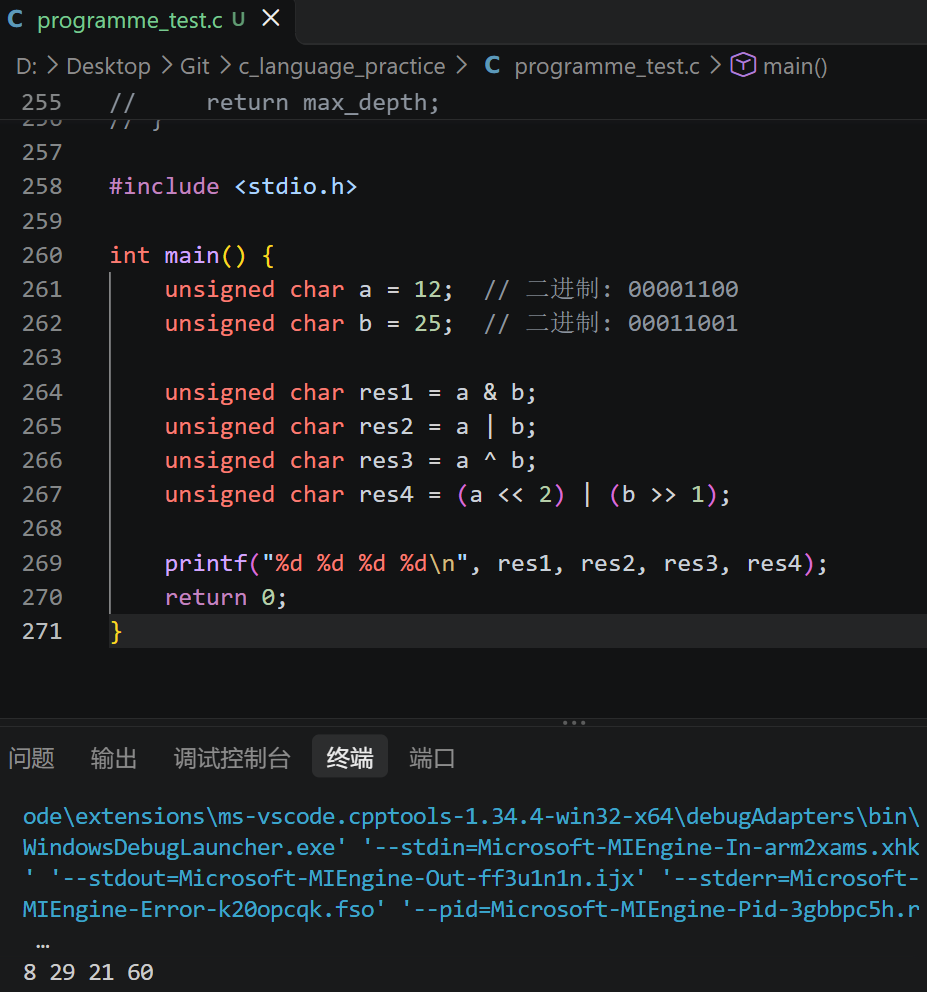

---

#### 2. 取整数 x 的第 n 位（0 还是 1）

先搞清楚"第几位"怎么数。题目例子：251 = 11111011，n = 3，结果返回 0。

题目的数法是**从 1 开始、从右往左数**：

思路1：造一个对应的第 n 位是 1 其他位都是 0 的数，把它和 x 按位与      （掩码法，掩码， mask）

```c
int get_bit_1(int x, int n)
{
    int mask = 1 << (n - 1);      // 造一个第n位是1、其他位是0的掩码

    // 和 x 按位与的结果为不等于零说明第n位是1，否则是0
    return((x & mask) != 0);
}
```

**【运行截图2】**

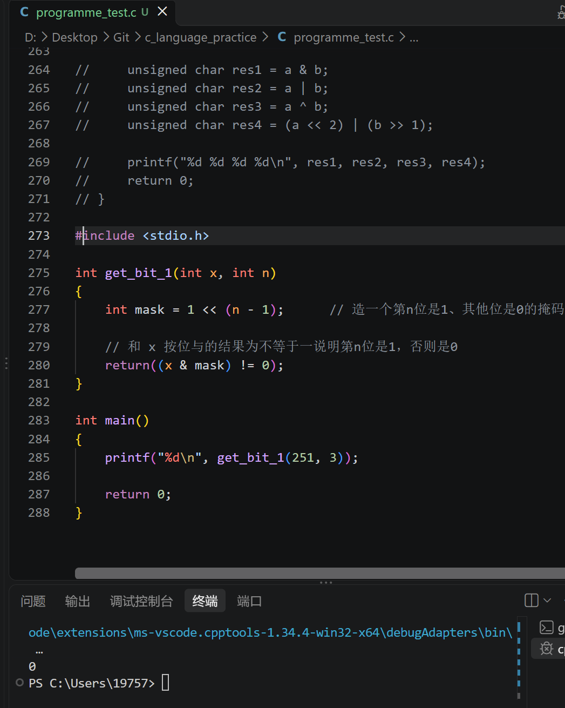


思路2：把第 n 位移动到第 0 位的位置，再和 1 按位与，把它单独"抠"出来。

```c
// 题目里 n 从 1 开始数，所以先把第 n 位移动 n-1 次到第 0 位
int get_bit_2(int x, int n)
{
    return (x >> (n - 1)) & 1;
}
```

**【运行截图3】**

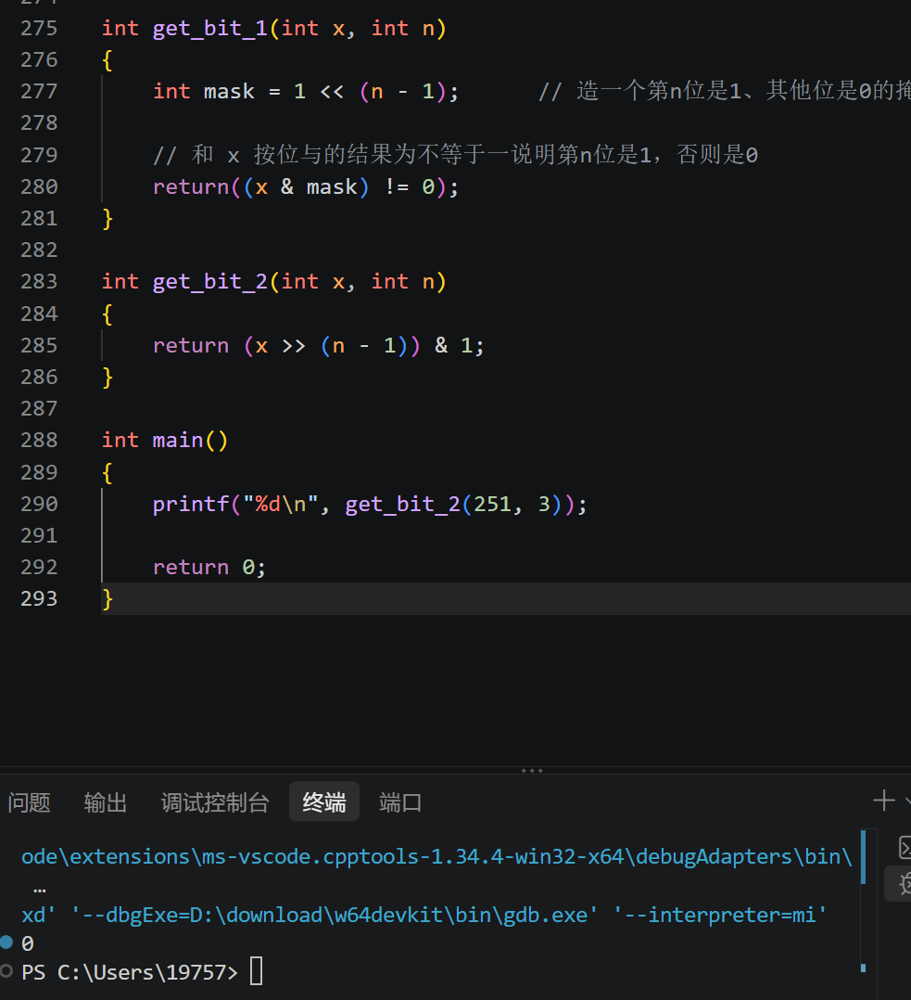

---

#### 3. 把第 n 位改成修正值 t（0 或 1）

分两种情况在纸上想：

- **改成 1 —— 用"或"点亮这一位。** 或的特点是：跟 1 或，结果一定是 1；跟 0 或，保持原样。所以
  `x | (1 << (n-1))`，只有第 n 位被置 1，其他位不动；
- **改成 0 —— 用"与"摁灭这一位。** 先构造一个"只有第 n 位是 0、其他位全是 1"的数，就是 `~(1 << (n-1))`。跟它按位与，第 n 位被 0 挡掉，其他位跟着 1 原样保留。

```c
int setBit(int x, int n, int t)
{
    int mask = 1 << (n - 1);
    if (t == 1)
        return x | mask;   // 点亮
    else
        return x & (~mask);  // 摁灭
}
```

**【运行截图4】**

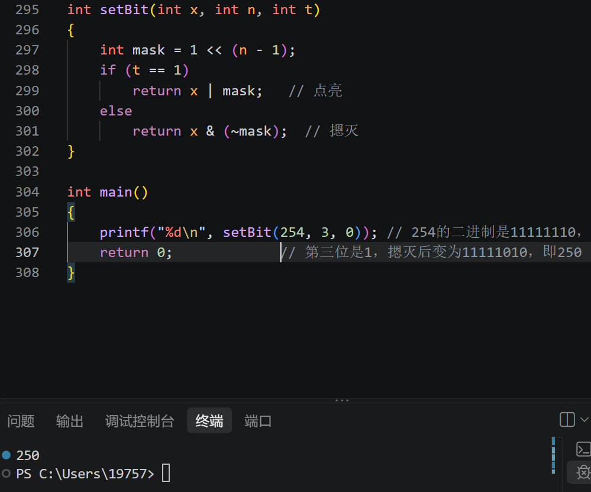

---

#### 4. 找二进制中从右数第一个 1，输出这一位表示的数

例：x = 10 = 1010，第一个 1 在从右数第 2 位，它表示的数是 2。

法1：从右往左一位一位找（自己第一遍想的）

```c
int find_first_one(int x)
{
    int mask = 1;       // 掩码：第i位是1、其他位是0
    
    // 从最右边一位开始
    for (int i = 1; i <= 32; i++)
    {
        if ((x & mask) != 0)     // 找到了这一位是1
        {
            return mask;         // 直接返回这个掩码
        }
        mask = mask * 2;         // 没找到，去看下一位
    }

    return 0;                    // 只有x=0时才会走到这（0没有1）
}
```

**【运行截图5】**

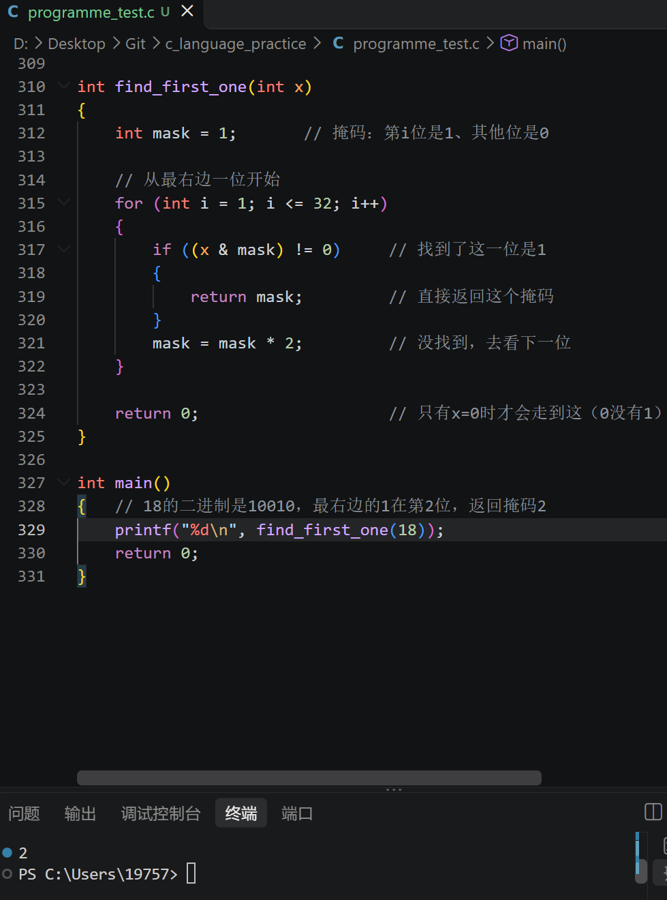

法2：补码（看视频学的）

结论是一个很经典的式子：**x & (-x)**，一般叫它 **lowbit**（最低位的那个 1 和它后边更低位的所有 0 组成的数）。

```c
int lowbit(int x)
{
    return x & (-x);
}
```

补码：在计算机里，**-x 等于 ~x + 1**（按位取反再加 1）。

以 10 为例（先只看 4 位，高位同理）：

```
 x   = 1010
~x   = 0101
~x+1 = 0110   （这就是 -10）
 x & -x = 1010 & 0110 = 0010 = 2
```

为什么恰好只剩最右边那个 1？假设 x 末尾有 k 个 0：

```
x    = ...1 00...0    （最右边的 1 后面跟着 k 个 0）
~x   = ...0 11...1    （那个 1 变成 0，后面的 0 全变成 1）
~x+1 = ...1 00...0    （加 1 后一路进位，后面的 1 又全变回 0，
                        原来那个 0 的位置被进位顶成 1）
```

- 低位：两边都是 0，与完是 0；
- 最右边那个 1：两边都是 1，与完是 1；
- 高位：-x 的高位部分是 x 高位的取反，x & ~x 恒为 0。

所以最后只剩下最右边那一个 1。

验证：`lowbit(10) = 2`；`lowbit(12)（1100）= 4`。特殊情况 x = 0 时没有 1，结果也是 0。

**【运行截图6】**

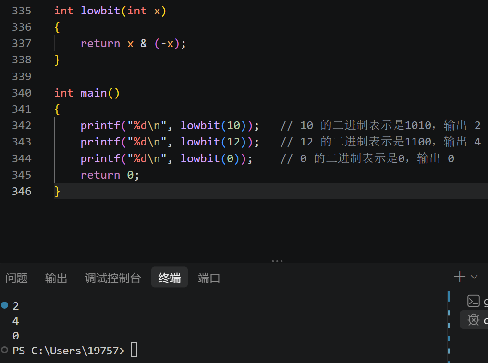

---

#### 5. 区间 [a, b] 内所有数按位与的结果（二进制编码最大 100 位）

##### 先把题目重新读一遍

原题："现在有两串无符号数 a 和 b 的二进制编码，并且有 a < b，每个数字的大小在 100 位以内，问区间 [a,b] 内 & 的结果。"

一开始我把"100 位"理解成了 100 位**十进制**数，写了一大段十进制字符串和二进制之间的转换，又长又看不懂，完全理解偏了。后来重新确认三点：

1. "100 位"指的是**二进制编码**（最多 100 位 0 和 1），不是十进制；
2. 输入直接就是二进制编码，不需要做任何进制转换；
3. 二进制编码默认**去掉前面的 0**（没有前导 0），就像十进制不会写成 "0012" 一样。

这样一来，这题就只是"对两个字符串做处理"。

##### 结论（先记住这个）

区间 [a,b] 所有数按位与的结果，就是 a、b 两串二进制编码的**公共前缀**：

- 两串**长度一样**：从最左边（最高位）开始，相同的位照抄，从第一次不一样的位置开始，后面全部写成 0；
- 两串**长度不一样**：没有公共前缀，结果直接就是 **0**。

##### 为什么是这样

###### 长度相同的情况

设 a、b 从最左边开始，第一次不一样的位置是第 k 位。因为 a < b，所以这一位 a 是 0、b 是 1。

从 a 一路数到 b，中间一定会经过这样一对相邻的数（前面相同的部分就叫"前缀"）：

```
m-1 = 前缀 0 111...1    （后面全是 1）
m   = 前缀 1 000...0    （后面全是 0）
```

这两个数都在 [a,b] 里面：

- m 后面的位全是 0，m-1 后面的位全是 1，所以后面每一位在区间里都被"0 过"一次，按位与之后第 k 位以及它后面的位全部是 0；
- 第 k 位上，a 自己本来就是 0，所以这一位也是 0；
- 前面的"前缀"部分，整个区间从头到尾都没变化（进位跨不到那么高），原样保留。

举个小例子，区间 [5,7]：

```
5 = 101
6 = 110
7 = 111
101 & 110 = 100
100 & 111 = 100
```

a = 101 和 b = 111 第一位相同（都是 1），第二位开始不同，结果就是 100，正好是"公共前缀 + 0"。

###### 长度不同的情况

b 比 a 长，区间一定跨过了"2 的某次幂"。比如 a = 111（7），b = 1000（8）：

- 区间里有 1000（2³，后面全是 0），也有 111（2³−1，全是 1）；
- 这两个数一位都对不上，按位与是 0。

更一般地说，设 b 有 k+1 位，那么 2^k（编码 100...0）和 2^k−1（编码 11...1，k 位）都在区间里，它俩一与就是 0，所以整个区间的结果也是 0。

##### 代码

输入是两串二进制编码（用字符串存），输出也是二进制编码：

```c
#include <stdio.h>
#include <string.h>

int main(void)
{
    char a[101], b[101];
    scanf("%s %s", a, b);

    int la = strlen(a);
    int lb = strlen(b);

    if (la != lb)
    {
        /* 长度不同，公共前缀为空，结果是 0 */
        printf("0\n");
        return 0;
    }

    /* 长度相同：从最左边（最高位）开始，数到第一次不一样的位置 */
    int i = 0;
    while (i < la && a[i] == b[i])
        i++;

    /* 前 i 位是公共前缀，从第 i 位开始（含）全部改成 0 */
    for (int j = i; j < la; j++)
        a[j] = '0';

    printf("%s\n", a);
    return 0;
}
```

几点说明：

- 用字符串存，是因为 100 位二进制远远超过 int（32 位）和 long long（64 位），但字符串想存多长就存多长；
- 字符串下标 0 对应最左边，也就是最高位，和写出来的二进制顺序一致，所以直接从下标 0 开始比；
- 输入没有前导 0，长度相同的情况下两个串第一位都是 1，所以结果第一位一定是 1，不用再处理前导 0（长度不同的情况直接输出 0）。

##### 测试

| 输入（二进制） | 输出（二进制） | 对应十进制验证 |
|---|---|---|
| 101 111 | 100 | 5 & 6 & 7 = 4 |
| 11010 11110 | 11000 | 26 到 30 按位与 = 24 |
| 111 1000 | 0 | 7 & 8 = 0 |
| 10 11 | 10 | 2 & 3 = 2 |
| 1010 1010 | 1010 | 只有 10，结果就是 10 |
| 0 0 | 0 | 0 |

**【运行截图11、12】**

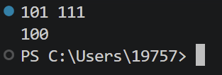

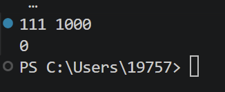

##### 拓展思考：把二进制结果再转成十进制（下面的东西我其实没看懂多少，不过思路我大概还是知道）

上面程序输出的是二进制。如果最后还想看到十进制结果，就有个麻烦：100 位二进制最大约 2^100 ≈ 1.27×10^30，是个 **31 位**的十进制数，而 long long 最多才 19 位，装不下。所以十进制结果同样得用字符串来存。

###### 思路：读一位，十进制数就"×2 再加这一位"

二进制转十进制有个很顺的规律。从左到右读二进制时，每多读一位，之前已经读到的数就相当于"往左挪了一位"——也就是整体乘 2，再加上刚读的这一位：

```
读 101：
  开始           十进制 = 0
  读第 1 位 1    十进制 = 0×2 + 1 = 1
  读第 2 位 0    十进制 = 1×2 + 0 = 2
  读第 3 位 1    十进制 = 2×2 + 1 = 5
```

这和按权展开（1×4 + 0×2 + 1×1 = 5）是一回事。剩下的问题就只是"十进制字符串怎么乘 2、怎么加 0/1"。

用手算乘法的方式：从个位（字符串最右边）开始，每一位乘 2，超过 9 就往高位进 1。而刚读的那一位（0 或 1），正好可以作为最开始丢给个位的进位——因为个位要算的本来就是"原来的个位 × 2 + 新读的位"。

###### 完整代码

```c
#include <stdio.h>
#include <string.h>

/* 把一个二进制字符串转换成十进制字符串，dec 数组要足够大 */
void binToDec(const char *bin, char *dec)
{
    int len = 1;          /* 十进制数一开始是 0 */
    dec[0] = '0';
    dec[1] = '\0';

    for (int i = 0; bin[i] != '\0'; i++)
    {
        int bit = bin[i] - '0';
        int carry = bit;  /* 初始进位就是这一位：相当于"乘 2"之后再加上它 */

        /* 从个位（最右边）开始，每一位乘 2 再加上进位 */
        for (int j = len - 1; j >= 0; j--)
        {
            int v = (dec[j] - '0') * 2 + carry;
            dec[j] = '0' + v % 10;
            carry = v / 10;
        }
        if (carry != 0)
        {
            /* 最高位还剩一个进位，把数字整体往后挪一位，前面放进位 */
            for (int j = len; j >= 0; j--)
                dec[j + 1] = dec[j];
            dec[0] = '0' + carry;
            len++;
        }
    }
}

int main(void)
{
    char a[101], b[101];
    scanf("%s %s", a, b);

    int la = strlen(a);
    int lb = strlen(b);

    if (la != lb)
    {
        /* 长度不同，结果是 0，把 a 改写成 "0"，方便后面统一转换 */
        a[0] = '0';
        a[1] = '\0';
    }
    else
    {
        /* 长度相同：从最左边数到第一次不同的位置，后面全部改成 0 */
        int i = 0;
        while (i < la && a[i] == b[i])
            i++;
        for (int j = i; j < la; j++)
            a[j] = '0';
    }

    printf("binary: %s\n", a);

    char dec[101];
    binToDec(a, dec);
    printf("decimal: %s\n", dec);
    return 0;
}
```

几点说明：

- `dec` 数组开 101 足够了：100 位二进制转成十进制只有 31 位左右；
- 长度不同时不再直接 `return 0`，而是把 a 改写成 `"0"`，这样两种情况最后都能统一走一遍转换；
- 最高位的进位处理用的是"把整串往后挪一位、再把进位填到最前面"，和手算时在最前面新写一位是一个道理。

###### 运行结果

```
输入 101 111      -> binary: 100    decimal: 4
输入 11010 11110  -> binary: 11000  decimal: 24
输入 111 1000     -> binary: 0      decimal: 0
输入 1010 1010    -> binary: 1010   decimal: 10
```

**我不得不承认上面这一坨我只了解了按权展开、字符串储存以及进位相关的思路，并没有完全掌握代码细节，但是我觉得可以先了解思路，等实际用到这块知识的时候再掌握细节。**

---

### 思考题

#### 1. 逻辑运算和位运算的区别与联系

**区别：**

- 逻辑运算（`&&`、`||`、`!`）把整个数当成"真假"：0 是假，只要非 0 就是真，结果只有 0 或 1，一般用在 if 的条件里；
- 位运算（`&`、`|`、`^`、`~`）是逐位(二进制)操作，每一位都参与运算（布尔运算），结果可以是任意整数。

举几个例子：

```c
3 && 5   // 两个都非 0，结果 1
3 & 5    // 011 & 101 = 001 = 1（这题碰巧一样）
4 && 2   // 两个都非 0，结果 1
4 & 2    // 100 & 010 = 000 = 0（这题就不一样了）
```

还有一个区别：`&&` 和 `||` 会**短路**。比如 `a && b`，如果 a 已经是假，b 根本不会被计算；位运算两边都要实打实算完，没有短路。写这种代码时短路很重要：

```c
if (p != NULL && *p == 0)   // p 是 NULL 时右边不会执行，避免了野指针解引用
```

**联系：** 对单独的一个位（0 或 1）来说，逻辑与/或/非和按位与/或/非的结果完全一样，因为一位的"真假"本来就是 0 和 1。我自己的理解是：**位运算相当于同时对 32 个一位布尔值做一遍逻辑运算**。

---

#### 2. 位运算有哪些性质（运算律）

查资料整理了一份，按我觉得用得上的顺序列：

- **交换律、结合律**：`&`、`|`、`^` 都满足，所以 `a & b & c` 不用纠结顺序和括号；
- **幂等**：`x & x = x`，`x | x = x`；
- **和 0、全 1 的关系**：
  `x & 0 = 0`，`x | 0 = x`；
  `x & 全1 = x`，`x | 全1 = 全1`；
- **分配律**：`&` 和 `|` 互相可以分配，
  `x & (y | z) = (x&y) | (x&z)`，
  `x | (y & z) = (x|y) & (x|z)`；
- **吸收律**：`x & (x | y) = x`，`x | (x & y) = x`；
- **德摩根律**：`~(x & y) = ~x | ~y`，`~(x | y) = ~x & ~y`；
- **异或的几条**：`x ^ x = 0`，`x ^ 0 = x`，`x ^ 全1 = ~x`（在固定位数内）；
- **双重否定**：`~(~x) = x`；
- **移位和乘除**：对无符号数，`x << n` 等于 x × 2ⁿ，`x >> n` 等于 x ÷ 2ⁿ 取整；
- **这章已经用到的两个技巧**：
  - `x & (x - 1)`：把最右边的 1 变成 0（N 皇后里枚举位置用）；
  - `x & (-x)`：只留下最右边的 1（任务 2 第 4 题的 lowbit）。

> 上面说的"全 1"要限定在二进制位数内，比如 8 位就是 11111111，即 0xFF。

---

#### 3. 为什么右移分算术右移和逻辑右移？（结合补码）

先理解补码。计算机里整数存的是补码：

- 正数的补码就是它本身；
- 负数的补码 = 对应正数按位取反，再加 1，最高位（符号位）是 1。

以 8 位为例：

```
+5 = 00000101
-5 = ~00000101 + 1 = 11111010 + 1 = 11111011
```

这样设计的好处是减法可以直接当加法算，硬件不用单独做减法器：

```
  00000011        （+3）
+ 11111011        （-5 的补码）
----------
  11111110        （-2 的补码，超出 8 位的进位丢掉）
```

两种“微妙”的右移：

- **逻辑右移**：左边空出来的位统一补 0，无符号数用它。
  11010110 逻辑右移 1 位 → **0**1101011；
  
- **算术右移**：左边补符号位（原来是 0 就补 0，原来是 1 就补 1），有符号数用它。
  11111011（-5）算术右移 1 位 → **1**1111101 = -3。
  
  
  
  为什么要区分：

- 无符号数没有"负"的概念，右移就是除以 2，空出来的高位补 0 天经地义；

- 有符号负数如果也机械地补 0，符号位会被 0 顶掉，一个负数就变成了一个很大的正数，结果完全错了。补符号位能保证符号不变，同时对于正整数来说右移仍然等价于"除以 2"，所以这种右移叫"算术"右移。

  但是算术右移不能保证负数右移仍然等价于"除以 2"，因为实际上c语言中是-5/2=-2(向零取整)，而不是刚才按算术右移算出来的-3（向下取整）。
  正因为两者对负数不相等，编译器不能随手把 x / 2 优化成 x >> 1—— 除非它能证明 x 是非负数。
  c语言中是-5/2=-2：
  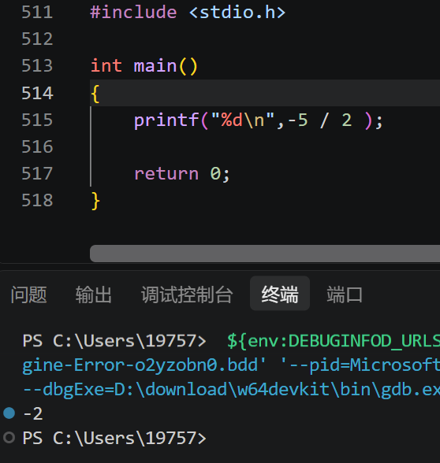

---

## 模块三：通信模块 —— 无碰撞协议

### 任务 3：字符串交集检测

题意：两个只含小写字母的字符串，判断它们有没有公共字符。要求空间复杂度 O(1)、时间 O(N)。

思路就是题目提示的：**把一个 int 当成 26 个开关用**。

- 26 个小写字母正好对应 int 的低 26 位。'a' 对应第 0 位，'b' 对应第 1 位，……，'z' 对应第 25 位；
- 遍历第一个字符串，出现过的字母就把对应位置 1，得到一个"出现过哪些字母"的位图 mask1；同样的方法得到 mask2；
- 如果某个字母在两个串里都出现过，它对应的位在两个 mask 里都是 1，那么 `mask1 & mask2` 就非 0，返回 1；否则返回 0。

字符对应的位号是 `'c' - 'a'`（比如 'c' - 'a' = 2，对应第 2 位）。同一个字母出现多次也没关系，`1 | 1` 还是 1，正好利用了或的幂等性。

```c
#include <stdio.h>

int hasCommonChar(const char *s1, const char *s2) {
    int mask1 = 0;
    int mask2 = 0;

    while (*s1 != '\0') {
        mask1 |= 1 << (*s1 - 'a');  
        s1++;
    }
    while (*s2 != '\0') {
        mask2 |= 1 << (*s2 - 'a');
        s2++;
    }

    return ((mask1 & mask2) != 0);
}
```

验证：

- `hello` 和 `world`：'l' 两边都有（hello 里有 ll，world 里有 l），'o' 也两边都有，返回 1；
- `abc` 和 `xyz`：没有任何字母重合，返回 0。

**【运行截图7】**

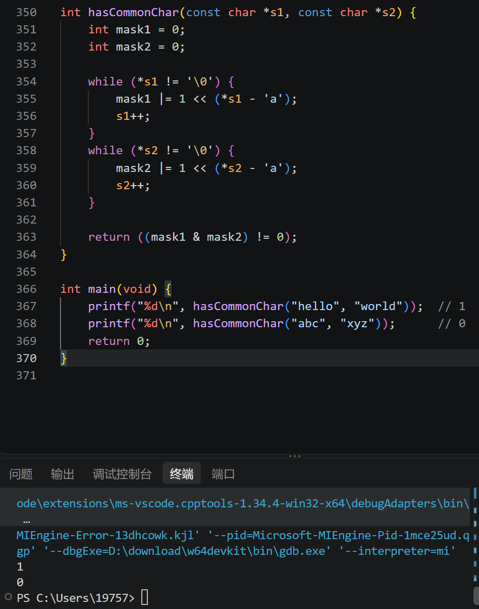

两个字符串各遍历一遍，**常数趟**的线性扫描，时间 O(N)；全程只用了两个 int，只使用**固定个数**的变量，没有额外开数组，空间 O(1)。

---

## 模块四：反应堆核心 —— 绝对平衡的艺术

### 任务 4：用位运算求解 N 皇后方案数

题意：N × N 的棋盘上放 N 个皇后（控制棒），要求任意两个不同行、不同列、不同一条斜线，求方案总数，N ≤ 15，要求用位运算做状态压缩。

**朴素思路**：一行一行放，每行放一个，天然保证不同行。放第 r 行时，要避开三类冲突：

1. 上面几行已经占了的列；
2. 上面的皇后向左下延伸的斜线；
3. 上面的皇后向右下延伸的斜线。

用三个整数充当"禁放位图"，某一位是 1 表示当前行对应列不能放：

- `cols`：已经被占的列；
- `diag1`：左下斜线（上一行的禁放位到下一行整体左移一格，所以往下传时 `<< 1`）；
- `diag2`：右下斜线（往下传时 `>> 1`）。

当前行能放的列，就是三个位图之外的位置：

```c
int full = (1 << n) - 1;   // 低 n 位全是 1，再往上的位全是 0, 把考虑范围限制在棋盘内
int can = full & ~(cols | diag1 | diag2); // 不被任意一种冲突禁止，并用掩码裁掉棋盘外的位
```

然后枚举 `can` 里每一个为 1 的位，每一个位都对应一种合法的放法：

```c
int p = can & (-can);   // 取出最右边的 1，作为这一行的位置
can &= can - 1;         // 把 can 里最右边的那个 1 清成 0，其余位原样保留，继续枚举下一个
```

选定位置 p 后递归到下一行，更新三个状态：

```c
dfs(row + 1,
    cols | p,            // 这一列以后不能再放
    (diag1 | p) << 1,    // 左下斜线：位置整体左移
    (diag2 | p) >> 1,    // 右下斜线：位置整体右移
    n);
```

斜线为什么一个左移一个右移？上一行第 c 列的皇后，它的左下斜线到这一行是第 c-1 列、右下斜线到这一行是第 c+1 列，所以整个禁放位图跟着 `<< 1` 和 `>> 1`。多出来的位不用管，下一层开头 `full & ~(...)` 会自动裁掉。

当放满 n 行（`row == n`）时，说明找到了一种合法方案，计数加 1。

```c
#include <stdio.h>

long long count_sol;

void dfs(int row, int cols, int diag1, int diag2, int n)
{
    if (row == n)
    {
        count_sol++;
        return;
    }

    int full = (1 << n) - 1;
    int can = full & ~(cols | diag1 | diag2);

    while (can != 0)
    {
        int p = can & (-can);    // 取出最右边的一个 1
        can &= can - 1;          // 把这一位从候选中清掉

        dfs(row + 1,
            cols | p,
            (diag1 | p) << 1,
            (diag2 | p) >> 1,
            n);
    }
}

int main(void)
{
    int n;  // n 为棋盘大小
    if (scanf("%d", &n) != 1)  // scanf 的返回值：它返回 "成功读到的数据的个数"
        return 0;

    count_sol = 0;
    dfs(0, 0, 0, 0, n);
    printf("%lld\n", count_sol);
    return 0;
}
```

本地跑了 N = 1～15 的结果：

| N | 方案数 |
|---|---|
| 1 | 1 |
| 2 | 0 |
| 3 | 0 |
| 4 | 2 |
| 5 | 10 |
| 6 | 4 |
| 7 | 40 |
| 8 | 92 |
| 9 | 352 |
| 10 | 724 |
| 11 | 2680 |
| 12 | 14200 |
| 13 | 73712 |
| 14 | 365596 |
| 15 | 2279184 |

N=15 时有 227 万种方案，虽然 int 也装得下，但计数变量还是用 long long 更稳妥。

**【运行截图8】**（以8*8为例）

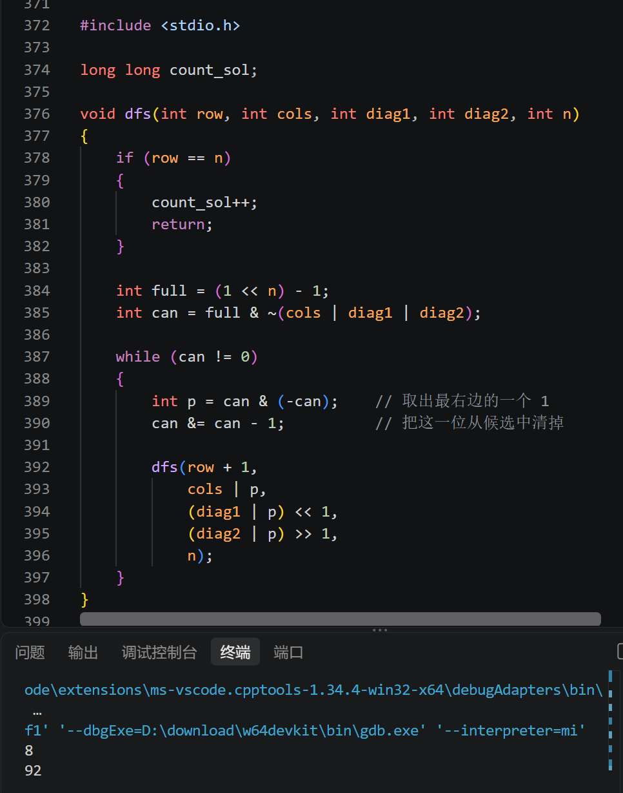

---

## 模块五：管道穿梭 —— 自动化寻路

### 任务 5：BFS 与位运算寻路

题意：一个 4×4 网格共 16 个节点，编号 0～15，从 0 走到 15。`walls` 的第 i 位为 1 表示节点 i 是墙；每次只能上下左右走一格；不能用布尔数组，访问状态要压进一个 int（visited）里。

BFS（广度优先搜索）按"一层一层往外扩"的方式搜索，从起点走到每个节点的步数就是它的层数，所以第一次搜到终点 15 时，记录的步数一定是最短步数。这题的重点是把"墙"和"访问记录"都换成 int 的位来表示。

先理清编号和行列的关系：`pos = 行 × 4 + 列`，所以

```c
int r = pos / 4;   // 行号
int c = pos % 4;   // 列号
```

补全 TO DO 部分的循环逻辑：

1. 队首取出一个节点 cur；如果它就是终点 15，直接返回它的步数；

2. 枚举上下左右四个方向，算出新位置的行列：
   - 行列超出 0～3，出界，跳过；
   - 新位置是墙：`walls & (1 << npos)` 非 0，跳过；
   - 新位置访问过：`visited & (1 << npos)` 非 0，跳过；
   - 否则标记已访问（`visited |= (1 << npos)`），把它和"步数 + 1"一起入队；
   
3. 队列空了还没到终点，说明到不了，返回 -1。

4. **front 每轮固定挪 1 个**：因为每轮只取出一个格子来处理

   **rear 每轮挪的个数不确定**：挪几个 = 这一轮处理的那个格子，周围**能走的格子有几个**

这里"查某一位是不是 1"、"把某一位置 1"正好就是任务 2 第 2、3 小题练过的套路。

```c
#include <stdio.h>
#include <stdbool.h>

// 定义简单队列结构用于 BFS
typedef struct {
    int pos;   // 当前节点编号 (0~15)
    int dist;  // 到达当前节点的最短步数
} Node;

int minStepsToCheese(int walls) {
    int start = 0;
    int target = 15;

    // 如果起点或终点本身是墙，直接不可达
    if ((walls & (1 << start)) || (walls & (1 << target))) {
        return -1;
    }

    // BFS 队列与访问位图
    Node queue[16];
    int front = 0, rear = 0;
    int visited = 0;

    // 起点入队并标记已访问
    queue[rear++] = (Node){start, 0};
    visited |= (1 << start);

    // 上、下、左、右四个方向的行列偏移量
    int dr[4] = {-1, 1, 0, 0};
    int dc[4] = {0, 0, -1, 1};

    // TO DO
    while (front < rear)
    {
        Node cur = queue[front++];
        if (cur.pos == target)
            return cur.dist;

        int r = cur.pos / 4;
        int c = cur.pos % 4;
        for (int i = 0; i < 4; i++)
        {
            int nr = r + dr[i];
            int nc = c + dc[i];
            if (nr < 0 || nr >= 4 || nc < 0 || nc >= 4)
                continue;                       // 出界
            int npos = nr * 4 + nc;
            if (walls & (1 << npos))
                continue;                       // 是墙
            if (visited & (1 << npos))
                continue;                       // 已经访问过

            visited |= (1 << npos);
            queue[rear++] = (Node){npos, cur.dist + 1};
        }
    }
    // END OF TO DO

    return -1; // 无法到达
}

int main(void) {
    int walls = (1 << 5) | (1 << 10);  // 5 号和 10 号格子是墙
    int steps = minStepsToCheese(walls);
    printf("Minimum steps: %d\n", steps);      // 应输出 6
    return 0;
}
```

测试用例 `walls = (1<<5) | (1<<10)`，输出 `Minimum steps: 6`。

最短路径之一：0 → 1 → 2 → 3 → 7 → 11 → 15，沿最上面一行走到右上角再贴着右边下来，共 6 步（曼哈顿距离本来就是 3+3 = 6，5、10 号墙都不在这条路上）。

**【运行截图9】**

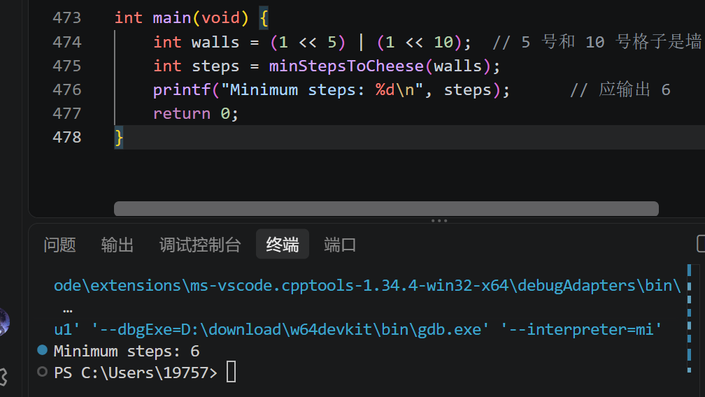

我另外自己加了一个不可达的测试：终点 15 只有 11 和 14 两个邻居，把它们俩都设成墙（`walls = (1<<11) | (1<<14)`），程序输出 -1，符合预期。

**【运行截图10】**

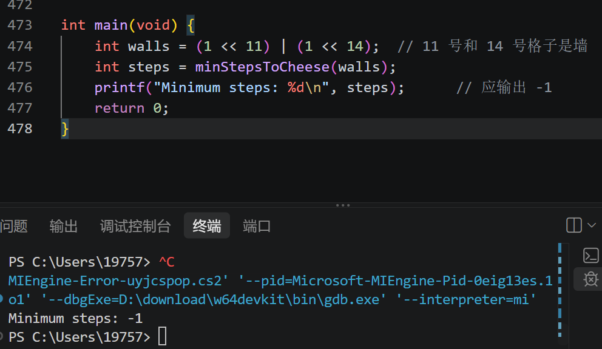

**BFS 的 dist 保证 = 逐层扩散（先近后远）+ 先进先出（按步数排队）+ visited 去重（只留第一次的最短值），三个加起来，出队的每个格子拿到的 dist 都是到它的最短步数。**

---

## 学习小结

这一章做完，几个我觉得最关键的点：

1. 计算机里所有信息最终都是二进制，十进制转二进制靠"除 2 取余、倒序读"，二进制转十进制靠按权展开；
2. 六个位运算符里，`& | ^ ~` 是逐位的逻辑操作，`<< >>` 是整体移动；判断奇偶、取某一位、置某一位、lowbit 是四个最常用的基础套路；
3. 两个位运算技巧要记住：`x & (x - 1)` 把最右边的 1 变 0，`x & (-x)` 只留最右边的 1，后者依赖补码（-x = ~x + 1）；
4. 区间 [a,b] 按位与的结果就是 a、b 的二进制公共前缀，后面补 0；数太大装不进内置类型时，用字符串模拟竖式运算做进制转换；
5. 位掩码的核心思想是：**一个 int 有 32 个可以独立开关的位**，字母去重、N 皇后的三类禁放状态、BFS 的访问记录都能压进去，省掉了数组；
6. 有符号负数用补码存储，所以右移才分算术右移（补符号位）和逻辑右移（补 0）；写代码时除以 2 还是老老实实写 `/ 2`，不依赖右移的具体行为。
